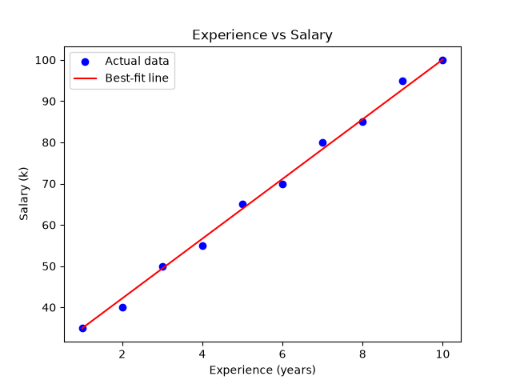

# Simple Linear Regression: Salary Prediction

A beginner machine learning project that predicts an employee's **salary** from their **years of experience** using Simple Linear Regression in Python.

Part of my learning path: **Python → Machine Learning → Agentic AI**.

## Project Goal

Learn the full regression workflow from scratch: prepare data, train a model, evaluate it, and visualize the result.

## Dataset

A small hand-made dataset of 10 employees:

| Feature | Description |
|---|---|
| `experience` | Years of experience (1 to 10) |
| `salary` | Salary in thousands |

## Tools Used

- Python
- Pandas
- NumPy
- Scikit-learn
- Matplotlib
- Jupyter Notebook (VS Code)

## Steps

1. Created the dataset with Pandas
2. Split it into features (`X`) and target (`y`)
3. Split data into 80% training and 20% testing (`train_test_split`)
4. Trained a `LinearRegression` model with `fit()`
5. Predicted salaries with `predict()`
6. Evaluated the model with MAE, MSE, RMSE and R²
7. Plotted the data with the best-fit line

## Results

The model learned this line:

```
salary = 7.24 × experience + 27.67
```

- Each extra year of experience adds about **7.24k** to the salary.
- Prediction for 7 years of experience: **78.36k**

| Metric | Value |
|---|---|
| MAE | 2.16 |
| MSE | 4.64 |
| RMSE | 2.16 |
| R² | 0.994 |

The model's predictions are off by about 2.16k on average, and it explains about 99.4% of the pattern in the data.



## Limitations

- The dataset is very small (10 rows), and the test set has only 2 samples, so the R² score should not be fully trusted.
- The model only uses experience. Real salaries depend on more factors such as skills, education and location.
- Predictions outside the 1 to 10 years range may be unreliable.

## What I Learned

- Regression predicts numbers, while classification predicts categories.
- How a model learns a line (`y = mx + c`) by minimizing error.
- Why we split data into training and testing sets.
- What MAE, MSE, RMSE and R² mean.

## Next Steps

- Multiple Linear Regression (more than one feature)
- Polynomial Regression
- Regularization (Ridge and Lasso)

## Author

**Shazia Batool**
AI student at COMSATS University | GitHub: [Shazia645](https://github.com/Shazia645)